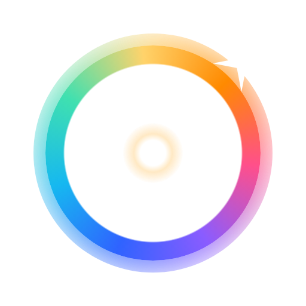

<p align="center"></p>

# LED Color für Hue 0.5.2

**Inoffizielle** Erweiterung für Home Assistant, die die offizielle Philips-Hue-Integration ergänzt.
Kein Produkt von Signify/Philips. «Philips» und «Hue» sind Marken von Signify.

Die offizielle Integration bleibt installiert. LED Color legt **keine** Lampen und **keine** Geräte an.
Jeder Zusatz erscheint direkt beim passenden Gerät der offiziellen Integration:
Verlauf und Einschaltverhalten bei der Lampe. Nur wenn ein Gerät fehlt, landet der Zusatz
beim Sammel-Gerät «LED Color».
Der technische Name ist `hue_plus` (Ordner, Aktionen, Entitäts-IDs). So bleiben bestehende
Dashboards und Automationen beim Umbenennen heil.

## Die Seite «LED Color»

Nach der Einrichtung erscheint in der Seitenleiste von Home Assistant **LED Color**:

- **Verläufe** – Lampe wählen, Farbpunkte antippen und Farbe wählen, Punkte ziehen, um die Reihenfolge zu ändern,
  Helligkeit und Verteilung einstellen. Die Lampe ändert sich sofort. Übertragen auf andere Lampen (auch gespiegelt).
- **Szenen** – alle Hue-Szenen mit ihren echten Farben, nach Raum. Antippen schaltet ein, das kleine Symbol startet
  die Szene dynamisch. Die aktive Szene leuchtet.
- **Neue Hue-Szene** – das Licht von jetzt als echte Hue-Szene in der Bridge speichern (inkl. Verläufe und
  dynamischer Palette). Sie erscheint sofort auch in der Hue App, in Home Assistant und auf Hue-Schaltern.
  Über «⋯» umbenennen, mit dem Licht von jetzt ersetzen oder löschen.
- **Favoriten** – eigene Verläufe speichern und mit einem Tipp auf beliebige Lampen legen. Gespeichert in
  Home Assistant, also auf allen Geräten gleich.
- **Einstellungen** – Einschaltverhalten aller Lampen auf einer Seite, nach Raum.
- **Koppeln** – zwei Lampen (z. B. beide Signe) bewegen sich gemeinsam, auf Wunsch gespiegelt.
- **Effekte** – Kerze, Kaminfeuer, Funkeln …, Sonnenaufgang/-untergang mit wählbarer Dauer.
- **Zurück** – letzte Änderungen rückgängig machen.
- Deutsch und Englisch (folgt der Sprache von Home Assistant).

Dasselbe gibt es als Karte fürs Dashboard: `type: custom:led-color-card` – Einstellungen siehe
[ANLEITUNG.md](ANLEITUNG.md).

## Was drin ist

| Was | Entität / Aktion | Beispiel |
|---|---|---|
| Farbverlauf lesen | `sensor.hue_plus_<lampe>_verlauf` | `sensor.hue_plus_wohnzimmer_signe_l_verlauf` |
| Einschaltverhalten nach Stromausfall | `select.hue_plus_<lampe>_einschaltverhalten` | |
| Farbverlauf setzen | `hue_plus.set_gradient` | siehe unten |
| Effekt starten | `hue_plus.set_effect` | `effekt: sunrise`, `dauer: 1200` |
| Farbverlauf kopieren | `hue_plus.copy_gradient` | siehe unten |

### Verlauf-Sensor – Attribute (stabil, für Dashboards)

| Attribut | Inhalt |
|---|---|
| `farben` | Hex-Farben in der Reihenfolge der Bridge, z. B. `["#2f63ff", "#16b8f0", "#ff8a00"]` |
| `modus` | `interpolated_palette`, `interpolated_palette_mirrored`, `random_pixelated`, `segmented_palette` – oder `einfarbig` (dann genau eine Farbe) |
| `helligkeit` | 0–100 (%) |
| `an` | `true` / `false` |
| `erreichbar` | `false`, wenn die Lampe keinen Strom hat (Wandschalter aus); `null` = unbekannt |
| `sync_aktiv` | `true`, solange Hue Sync / Entertainment die Lampe steuert (dann sind `farben` nicht live) |
| `effekt` | z. B. `candle`, `fire` – sonst `null` |
| `punkte_max`, `pixel`, `modi`, `licht_id` | technische Zusatzinfos |

Die Farben sind «volle Leuchtkraft», die Helligkeit steht separat.
Der Zustand des Sensors ist die Anzahl Farben (z. B. «3 Farben»); die Farben stehen nur im Attribut
und werden nicht in der Datenbank gespeichert. Weitere Attribute: `effekte`, `zeit_effekte`, `form`.

### Einschaltverhalten

| Wert | Bedeutung |
|---|---|
| Hue-Standard (hell, warmweiss) | Werkseinstellung |
| Wie vor dem Stromausfall | war die Lampe aus, bleibt sie aus |
| An mit letzter Farbe | geht immer an, mit Farbe/Helligkeit vom letzten Mal |
| Eigene Einstellung (Hue App) | nur anzeigen, ändern nur in der Hue App |

### Aktionen

```yaml
action: hue_plus.set_gradient
target:
  entity_id: light.wohnzimmer_signe_l      # offizielle Lampe ODER sensor.…_verlauf
data:
  farben: ["#2f63ff", "#16b8f0", "#ff8a00"]  # 2 bis 5 Farben; 1 Farbe = einfarbig
  modus: interpolated_palette              # optional
  helligkeit: 80                           # optional, %
  uebergang: 1.5                           # optional, Sekunden
```

```yaml
action: hue_plus.copy_gradient
target:
  entity_id: light.wohnzimmer_signe_r
data:
  von: light.wohnzimmer_signe_l
  gespiegelt: true                 # optional: Reihenfolge umdrehen
  helligkeit_uebernehmen: true     # optional (Standard: ja)
  uebergang: 1                     # optional, Sekunden
```

Kann das Ziel keinen Verlauf (z. B. normaler Lightstrip), bekommt es die Mischfarbe.

## Installation über HACS

HACS → ⋮ → *Benutzerdefinierte Repositories* → Adresse dieses Repositories, Typ *Integration* →
«LED Color für Hue» installieren → Home Assistant neu starten → *Integration hinzufügen* → «LED Color für Hue» →
Knopf auf der Bridge drücken.

## Technik

- Einrichtung über die Oberfläche, Live-Updates über den Event-Stream der Bridge (kein Abfragen)
- Verbindet sich ausschliesslich mit der eingegebenen Bridge, nichts ins Internet
- Schlüssel liegt nur in Home Assistant, nie in diesen Dateien; Diagnose-Download ohne Schlüssel
